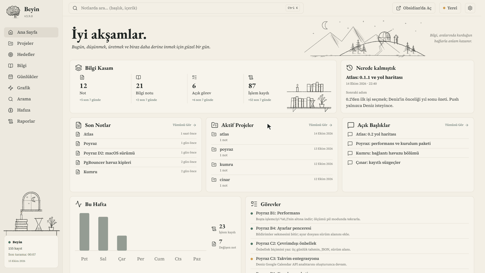

# beyin-web

**Beyin yazar, sen okursun.** beyin-web, [avenoxbeyin](https://github.com/avenoxai/avenoxbeyin) (Beyin) kurulu bir vault'u tarayıcıda açan küçük bir arayüz. Ajanının zamanla biriktirdiği projeler, görevler, iş kayıtları ve hafıza dosyaları dosya ağacının içinde kaybolmasın diye var: hepsini Obsidian bilmeden gezilebilen sade sayfalara dizer.

Sürüm 0.2.1 · [Neler değişti](CHANGELOG.md) · [Kurulum rehberi](docs/INSTALL.md) · MIT



*Görüntüdeki kişi, projeler ve notlar uydurmadır.*

## Başlamadan önce

- **Beyin kurulu bir vault.** beyin-web kendi başına not tutmaz; gösterdiği her şeyi Beyin ve onunla çalışan ajanın yazar. Beyin'siz bir klasörde sayfalar boş kalır. Beyin'i henüz kurmadıysan [buradan](https://github.com/avenoxai/avenoxbeyin) başla.
- **Python 3.11 ya da daha yenisi.** Hepsi bu: ek paket, Node, derleme ya da hesap yok.
- **Güncel bir tarayıcı:** Edge, Chrome ya da Firefox.

## Kurulum

### Ajanına kurdur

Beyin'i ajanına kurdurduysan bunu da öyle yapabilirsin. Vault klasörünü Claude Code, Codex ya da kullandığın başka bir ajanla aç ve şunu yaz:

```text
https://raw.githubusercontent.com/AyberkOzkan/beyin-web/main/beyin-web.md dosyasındaki rehbere göre beyin-web'i bu vault için kur. Zaten kuruluysa güncelle. Bitince kısayoldan birlikte açıp bakalım.
```

Rehber ajana adım adım ne yapacağını söyler: uygun Python'u arar, son sürümü GitHub'dan indirip SHA-256 özetini karşılaştırır, kurar ve vault'una tek bir dosya bile eklenmediğini kontrol eder. Senden isteyeceği en fazla şey, Python kurmak gerekirse yönetici parolan. GitHub hesabına gerek yok.

### Kendin kur

[Sürümler sayfasından](https://github.com/AyberkOzkan/beyin-web/releases/latest) `beyin-web-0.2.1.zip`'i indir. İstersen yanındaki `.sha256` dosyasıyla indirdiğin paketin bozulmadığını kontrol edebilirsin. ZIP'i bir yere aç, o klasörde bir terminal aç ve kendi vault yolunla:

```sh
# Linux, macOS, WSL
python3 -m beyin_web --install --vault "/home/deniz/Beyin"
```

```powershell
# Windows
py -3 -m beyin_web --install --vault "C:\Users\deniz\Documents\Beyin"
```

> Ubuntu 22.04'teki `python3` 3.10'dur ve yetmez. `sudo apt install python3.11` ile yenisini yanına kur, komutu `python3.11` ile çalıştır; sistemin `python3`'üne dokunma.

Komut arayüzün bir kopyasını kullanıcı klasörüne alır, vault yolunu ayarlara yazar ve bir kısayol bırakır. ZIP'i ve açtığın klasörü artık silebilirsin.

| Nerede | Kısayol |
| --- | --- |
| Windows | Başlat menüsü ve masaüstü: **Beyin Web** |
| Linux | Uygulama menüsü: **Beyin Web** |
| macOS | Masaüstü: `Beyin Web.command` |
| WSL | Windows'un Başlat menüsü ve masaüstü: **Beyin Web** (tıklayınca WSL'i kendisi açar) |

Depoyu klonladıysan `scripts/beyin-web --install --vault …` (Windows'ta `scripts\beyin-web.cmd`) da aynı işi görür ve uygun Python'u kendisi bulur. Sorun çıkarsa: [kurulum rehberi](docs/INSTALL.md).

Windows 11'de ve WSL'de (Ubuntu) kısayola gerçekten tıklanarak denendi. Linux masaüstü ve macOS kısayolları şimdilik yalnızca otomatik testlerden geçti; bir sorun görürsen issue açman çok işe yarar.

## Neler var?

Markdown dosyaları Beyin için doğru bir tercih, ama bir dosya listesine bakıp "nerede kalmıştık?" sorusunu yanıtlamak zor. Her sayfa tek bir soruya cevap verecek şekilde kuruldu:

| Sayfa | Sorduğun | Nereden okur |
| --- | --- | --- |
| Ana Sayfa | Nerede kalmıştık, şu an ne açık? | Son oturum kartı, açık konular, görevler, receipt'ler |
| Projeler | Bu proje ne durumda, sırada ne var? | `project` alanı, proje notu, `tasks/`, receipt'ler |
| Hedefler | Kendime ne hedef koydum, ne kadar yol aldım? | `kind: goal` ve `kind: habit` notları (`goals/`) |
| Bilgi | Bu konuda ne öğrenmiştik? | `knowledge/` notları ve bağlantıları |
| Günlükler | O gün ne yapıldı? | `receipts/` ve oturum kartları |
| Grafik | Notlar birbirine nasıl bağlanıyor? | Wikilink'ler ve receipt kaynakları |
| Arama | Bu kelime nerede geçiyor, Beyin ne hatırlıyor? | Yerel kelime araması ve `beyin.py context` |
| Hafıza | Ajan beni nasıl tanıyor, hangi kurallara uyuyor? | Companion klasörü: kimlik, kurallar, son oturum, konular |
| Raporlar | Bu hafta ne oldu, birikim nereye gidiyor? | Receipt'lerden ve notlardan sayılır; yapay zekâ özeti değildir |

## Kullanırken

Kısayola tıkla, tarayıcıda açılsın. Zaten açıksa ikinci tıklama yeni bir sunucu başlatmaz, çalışanı yeniden açar.

- **Sağ üstteki dişli:** dil (Türkçe ya da İngilizce), imleç ve Beyin'in rehberlerine kısa yollar.
- **İşin bitince:** dişli → **Arayüzü kapat**. Unutursan dert değil; yarım saat dokunulmazsa kendini kapatır.
- **Obsidian'a geçmek:** üst çubuktaki düğme, baktığın notu ya da vault'u doğrudan Obsidian'da açar.

Kurmadan bir göz atmak istersen paketin ya da deponun klasöründe `python3 -m beyin_web --vault "/home/deniz/Beyin" --open` yeter.

Arayüzü Beyin'le aynı yerde çalıştır: Beyin WSL'deyse arayüz de WSL'de. Başka bir yerden açman gerekirse `--no-beyin` ekle; notlar yine görünür, yalnızca Beyin'e soru sorulmaz (buna yalın kip diyoruz). Tarayıcı kendiliğinden açılmazsa terminalde yazan `beyin-web adresi: …` satırını kopyala; kapatmak için `Ctrl+C`.

## Güncellemek ve kaldırmak

En kolayı yine ajana söylemek: "beyin-web'i güncelle". Kendin yapacaksan yeni ZIP'i indirip aynı kurulum komutunu çalıştır; ayarların yerinde kalır. Arayüz açıksa önce kapat, yoksa kısayol eski kopyayı göstermeye devam eder.

Vazgeçersen paket klasöründe aynı komutu `--install --vault …` yerine `--uninstall` ile çalıştır. Kısayol ve kopya gider; ayarların ve vault'un olduğu gibi kalır.

beyin-web kendi kendine güncelleme aramaz, internete hiç çıkmaz. Yeni sürümleri [sürümler sayfasından](https://github.com/AyberkOzkan/beyin-web/releases) izleyebilirsin.

## Vault'una ne yapar?

Kısa cevap: neredeyse hiçbir şey.

- **Okur.** Her şeyi vault'taki Markdown dosyalarından okur. Beyin'in durum klasörüne (indeks, yedekler) hiç girmez.
- **Beyin'e yalnızca iki şey sorar:** `doctor` (sürüm ve sağlık) ve `context --no-sync` (bağlam araması). İkisi de bir şey yazmaz; `sync`, `receipt`, `task-update` gibi yazan komutlara hiç dokunmaz.
- **Tek istisna Hedefler.** Yazma varsayılan olarak açıktır. Yeni hedef ve alışkanlıklar `goals/` klasörüne sıradan Markdown olarak yazılır; yalnızca bu klasördeki hedef ve alışkanlıklar değiştirilir ya da `.trash`'e taşınır. Beyin bir sonraki senkronda onları da görür. Çöp Kutusu yalnızca `.trash` içindeki hedef ve alışkanlık notlarını geri alır ya da, onay istedikten sonra, kalıcı olarak siler; bu silme geri alınamaz. Yazmayı tümüyle kapatmak için `--read-only` ya da `config.json` içinde `"read_only": true` kullan.
- **Gizli olan gizli kalır.** `visibility: private` bir not hiçbir sayfada, aramada ya da grafikte görünmez.
- **Not düzenleyici değildir.** Notları yazmak ve değiştirmek Obsidian'ın ve ajanının işi. Raporlar da yalnızca eldeki kayıtları sayar; model çağrılmaz.
- **Ayrı bir proje.** avenoxbeyin'in parçası değil ve onun güncellemesiyle gelmez; aynı lisansla (MIT) bu depoda geliştiriliyor.

Şimdilik olmayanlar: koyu tema ve telefon düzeni (en dar genişlik **1.024 px**). Arama `ı` ile `i`'yi ayırmaz.

## Güvenlik

Sunucu yalnızca `127.0.0.1` üzerinde dinler; dışarı ağ isteği, telemetri ya da CDN yoktur. İlk adres bir giriş belirteci taşır: açılışta `HttpOnly; SameSite=Strict` bir çerez konur ve belirteç adres çubuğundan kaldırılır. Çerez, her sunucu açılışında üretilen ve sunucu kapanınca geçersizleşen bir oturum değeri taşır; kalıcı belirteç yalnızca giriş adresinde kullanılır. `--reuse` çalışan arayüzü ayar klasöründeki `running/<port>.json` kilit dosyasından bulur. Belirteç ayar klasöründeki `login-token` dosyasında durur; ayar klasörü vault'un içinde olamaz. 0.2.0'dan kalan `token` dosyası ve 30 günlük eski çerez ilk açılışta silinir; eski belirteç artık geçmez. **Belirteçli adresi paylaşma.**

Yazma varsayılan olarak açıktır. Arayüz yalnızca `goals/` altındaki hedef ve alışkanlık notlarını değiştirir ya da `.trash`'e taşır. Çöp Kutusu'ndan kalıcı silme yalnızca `.trash` içindeki hedef ve alışkanlık notları için vardır ve geri alınamaz. `--read-only` ya da `config.json` içinde `"read_only": true` yazmayı tümüyle kapatır.

Okuma uçları GET ve HEAD kullanır. Yazan uçlar Hedefler'in sekiz POST ucu ve hiçbir dosyaya yazmayan "Arayüzü kapat" ucudur; hepsi isteğin arayüzün kendi sayfasından geldiğini (`Origin`, JSON türü ve özel başlık) denetler, başka bir sitenin ya da formun isteğini reddeder. Katı CSP uzak kaynakları ve satır içi betikleri engeller. Gizli notlar veri katmanında elenir.

Bir güvenlik açığı bulursan herkese açık issue yerine deponun **Security** sekmesindeki **Report a vulnerability** ile özel olarak bildir.

**Yalın kip**, arayüzün Beyin'in çalışma zamanına ulaşamadığı durumdur (`beyin.py` vault'ta yok, `--no-beyin` verilmiş ya da Beyin başka ortamda kurulu). Notlar, projeler, görevler, günlükler, grafik, hafıza dosyaları ve yerel arama yine görünür; Beyin'in bağlam araması, sağlık ve sürüm bilgisi görünmez. Bu kip Beyin'in yerini tutmaz: gösterilen kayıtları yine Beyin üretmiş olmalı.

## Seçenekler ve ayarlar

| Seçenek | Anlamı |
| --- | --- |
| `--vault YOL` | Okunacak vault klasörü; boşluk içeren yolları tırnakla. |
| `--port SAYI` | Başlangıç portu; varsayılan 7373. Doluysa sonraki 20 porta kadar boş port aranır. `0` boş port seçtirir. |
| `--open` | Tarayıcıyı giriş adresiyle açar. |
| `--idle-exit DAKİKA` | Bu süre boyunca istek gelmezse kapanır (pozitif tam sayı). Varsayılan kapalı; açık bir sekme istek gönderebilir. |
| `--no-token` | Belirteç ve çerez denetimini kapatır; yalnızca tek kullanıcılı makine için. |
| `--no-beyin` | Yalın kipi zorlar; Beyin CLI'ı çağrılmaz. |
| `--read-only` | Vault'a hiçbir şey yazılmaz; Hedefler sayfası yalnızca gösterir. |
| `--lang tr\|en` | Arayüzün ve terminal mesajlarının varsayılan dili; verilmezse Türkçe. |
| `--install` | Bu kullanıcı için kurar: kopya, vault ayarı ve kısayol. `--vault` ve `--lang` ile birlikte verilir. |
| `--uninstall` | Kısayolları ve kurulu kopyayı siler. |
| `--reuse` | Aynı vault için çalışan bir arayüz varsa yenisini başlatmaz, onun adresini açar. Kısayol bunu kullanır. |
| `--version` | `beyin-web 0.2.1` yazdırıp çıkar. |

Vault şu sırayla aranır: `--vault` → `BEYIN_VAULT` → `config.json` içindeki `vault` → bulunulan klasör (içinde `beyin.py` veya `.obsidian` varsa). Göreli yollar bulunulan klasöre göre çözülür. Öncelikli yol geçersizse sonraki aday denenmez.

`config.json` yeri:

- Windows: `%APPDATA%\beyin-web\config.json`; `APPDATA` yoksa `~/.config/beyin-web/config.json`.
- Linux, macOS ve WSL: `XDG_CONFIG_HOME` tanımlıysa `$XDG_CONFIG_HOME/beyin-web/config.json`, yoksa `~/.config/beyin-web/config.json`.

Kurulum bu dosyayı senin yerine yazar; elle de oluşturabilirsin:

| Anahtar | Değer |
| --- | --- |
| `vault` | Vault yolu (metin). |
| `port` | 0–65535 arasında tam sayı; geçersizse 7373. `--port` önceliklidir. |
| `display_name` | Ana Sayfa'daki selamlamada kullanılan ad (metin). |
| `beyin` | `false` ise Beyin çağrıları kapatılır. |
| `read_only` | `true` ise vault'a yazılmaz (`--read-only` ile aynı). |
| `language` | `"tr"` ya da `"en"`; arayüzün varsayılan dili. `--lang` önceliklidir. |

```json
{
  "vault": "C:\\Users\\KULLANICI\\Documents\\Beyin",
  "port": 7373,
  "display_name": "Deniz",
  "beyin": false
}
```

Arayüz Türkçe ve İngilizcedir (*the interface is available in Turkish and English*). Ayarlar'dan seçtiğin dil tarayıcıda saklanır ve `--lang` ile `language` ayarının önüne geçer. Adresler (`#/projeler`) ve notların içeriği dile göre değişmez.

## Hedefler vault'ta nasıl durur?

Hedefler sıradan Markdown notlarıdır. Obsidian'da ya da ajanınla da yazabilirsin; arayüz hepsini gösterir.

```markdown
---
{
  "kind": "goal",
  "horizon": "year",
  "period": "2026",
  "area": "Öğrenme",
  "visibility": "internal"
}
---
# 12 kitap okumak

- [x] Birinci kitap
- [ ] İkinci kitap
```

- `horizon`: `long` (uzun vadeli), `year` (yıl hedefi) ya da `theme` (yılın teması; adımı olmaz, ilk paragrafı gösterilir).
- İlerleme nottaki görev kutularından sayılır. Arayüzde bir adımı işaretlemek o satırdaki tek karakteri değiştirir.
- Alışkanlık `"kind": "habit"` notudur; yapılan her gün `- 2026-01-12` biçiminde bir satırdır.
- Arayüzden eklenen notlar `goals/` klasörüne yazılır; var olan bir dosyanın üzerine yazılmaz. Not arayüz açıkken başka bir yerde değiştiyse arayüz kendi değişikliğini bırakır ve güncel hali gösterir.
- Silinen hedef ya da alışkanlık yok edilmez: vault'un `.trash` klasörüne (Obsidian'ın çöp kutusu) taşınır ve Hedefler sayfasının altındaki Çöp Kutusu'nda görünür. Oradan geri alınır ya da onay verirsen kalıcı olarak silinir; kendiliğinden hiçbir şey silinmez. Çöp Kutusu `.trash` içindeki başka notlara dokunmaz.
- Başlığı ya da adımların metnini düzeltmek için notu Obsidian'da aç; arayüz metin düzenlemez.
- `"visibility": "private"` bir hedef arayüzde hiç görünmez.

## Çizimler

Arayüzde karakalem tarzında 31 çizim var: Ana Sayfa karşılamasında, yan menünün altında, sayfa başlıklarında, kart köşelerinde ve boş kutularda. Bunlara ek olarak 16 küçük karalama (spiral, yıldız, kâğıt uçak, XOX…) sayfanın boş kalan yerlerine serpiştirilir; dolu bir sayfada görünmezler. Her yer kendi çizimlerinden birini rastgele seçer; seçim sayfa yeniden yüklenene kadar değişmez.

Kendi çizimini eklemek için dosyayı kurulu kopyadaki `beyin_web/static/img/` klasörüne yuvanın adıyla koy: `hero-palace-benim.png`, `sidebar-tree-2.svg`, `heading-mountains-kis.webp`, `card-window-01.png`, `margin-doodle-kedi.png` gibi (küçük harf, rakam ve tire; PNG, SVG ya da WebP). Arayüz yeniden başlayınca o da seçilenler arasına girer. Kâğıt zemine oturması için arka planı saydam ya da beyaz olmalı. Güncelleme kurulu kopyayı baştan yazar; kendi çizimlerinin bir kopyasını ayrıca sakla ve güncellemeden sonra yeniden koy.

## Beyin için başlatıcı (önizleme)

Depodaki `upstream/beyin_v3_web.py`, Beyin'e eklenebilecek küçük bir başlatıcıdır. Beyin'e alınırsa kurulum `beyin.py web kur` olur ve vault yolu sorulmaz. O zamana kadar dosya tek başına çalışır:

```sh
python3 upstream/beyin_v3_web.py --vault "/home/deniz/Beyin" kur
python3 upstream/beyin_v3_web.py --vault "/home/deniz/Beyin" durum
```

| Komut | Yaptığı |
| --- | --- |
| `kur [--paket ZIP] [--kisayol-yok] [--dil en]` | Dosyada sabitlenen sürümü GitHub'dan indirir (ya da `--paket` ile verileni okur), dosyada yazılı SHA-256 ile doğrular, Beyin'in durum klasöründe `web/<sürüm>/` altına açar ve kısayol bırakır. Özet tutmazsa hiçbir şey yazılmaz. |
| `ac` | Kurulu sürümü bu vault ile açar. |
| `durum` | Kurulu mu, hangi sürüm, güncel mi, çalışıyor mu. |
| `kaldir` | Kısayolu ve kurulu kopyayı siler; vault'a ve ayarlara dokunmaz. |

## Geliştirmek istersen

```sh
python -m unittest discover -s tests -t .
node --test tests/js
```

`tests/e2e/` altındaki tarayıcı testleri aynı Python komutuna dahildir; Selenium ve yerel Edge sürücüsü bulunmazsa atlanır. Ayrı çalıştırmak için `python -m unittest discover -s tests/e2e -t .`. Linux, macOS ve WSL'de gerekirse `python` yerine `python3`, Windows'ta `py -3` kullan. Testler gerçek bir vault okumaz ve dışarı ağ isteği yapmaz.

Sürüm paketi: `python3 scripts/build_release.py` her makinede aynı baytları veren ZIP'i ve `.sha256` dosyasını `dist/` altına yazar, sürümü ve özeti başlatıcıya işler. Sürüm sayfasındaki dosyalar bunlardır.

Salt okunur performans ölçümü (kendi vault yolunla):

```sh
python scripts/measure.py VAULT
python scripts/measure.py VAULT --api --no-beyin --repeat 20 --idle 60
```

İlk komut ilk ve tekrar tarama sürelerini, türlere göre sayıları, uyarıları ve belleği yazdırır; ikincisi yerel API'nin sürelerini ve boştaki işlemci kullanımını ekler. Bellek yalnızca `/proc/self/status` olan sistemlerde ölçülür. Beyin çağrılarını da ölçmek için `--no-beyin`'i kaldır.

[Kurulum rehberi](docs/INSTALL.md) · [Performans raporu](docs/PERFORMANCE.md) · [Neler değişti](CHANGELOG.md) · Lisans: [MIT](LICENSE)

## In English

beyin-web is a local web interface for [avenoxbeyin](https://github.com/avenoxai/avenoxbeyin) ("Beyin"), a local second brain for coding agents that keeps everything in Markdown inside an Obsidian vault. It shows what Beyin has written there (projects, tasks, receipts, session cards, rules, knowledge notes) on plain pages, for people who do not want to learn Obsidian. **It needs a vault managed by Beyin; on its own it has nothing to show.** It never writes to Beyin's state folder, calls only `doctor` and `context --no-sync`, and writes to the vault only from the Goals page. Python 3.11+, no dependencies, no build step. To install, open your vault in your AI client and ask it to read [beyin-web.md](https://raw.githubusercontent.com/AyberkOzkan/beyin-web/main/beyin-web.md) and install beyin-web; or download the package from the [latest release](https://github.com/AyberkOzkan/beyin-web/releases/latest) and run `python3 -m beyin_web --install --vault "/home/deniz/Beyin"` in its folder. The interface is in Turkish and English (Settings, or `--lang en`); the documentation is in Turkish.

Security: the server listens only on `127.0.0.1`, with no external requests, telemetry or CDN. The `HttpOnly; SameSite=Strict` cookie carries a session value that becomes invalid when the server stops; the persistent token (`login-token` in the configuration folder) is used only in the login URL. Do not share that URL. The `token` file and the 30-day cookie left by 0.2.0 are removed on first start, so the old token no longer works. `--reuse` finds the running interface through a `running/<port>.json` lock file in the configuration folder.

Writing is enabled by default. The interface changes or moves to `.trash` only goal and habit notes under `goals/`. Permanent deletion from the Bin is available only for goal and habit notes inside `.trash` and cannot be undone. `--read-only` or `"read_only": true` in `config.json` disables all vault writes. Write requests require the page's own origin, JSON and a custom header; a strict CSP blocks remote resources and inline scripts, and private notes are filtered before reaching the interface.
