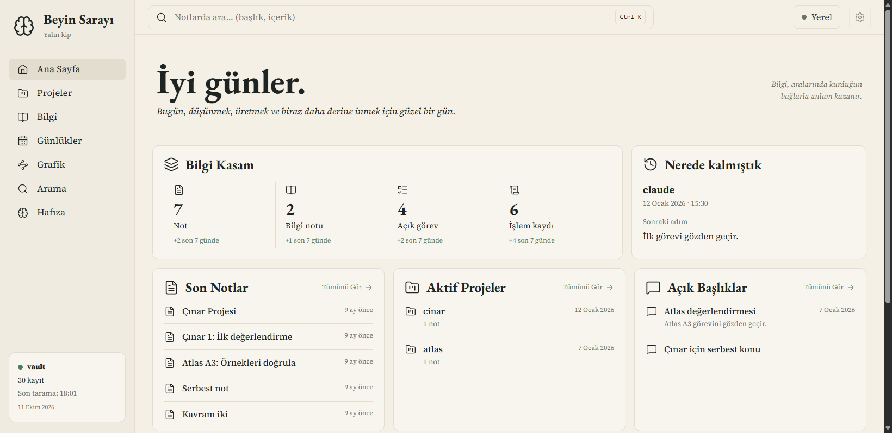
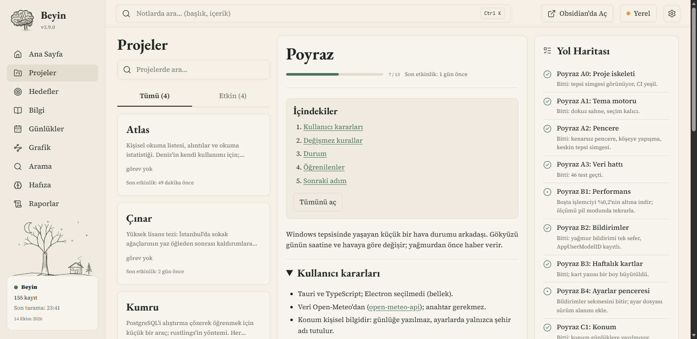
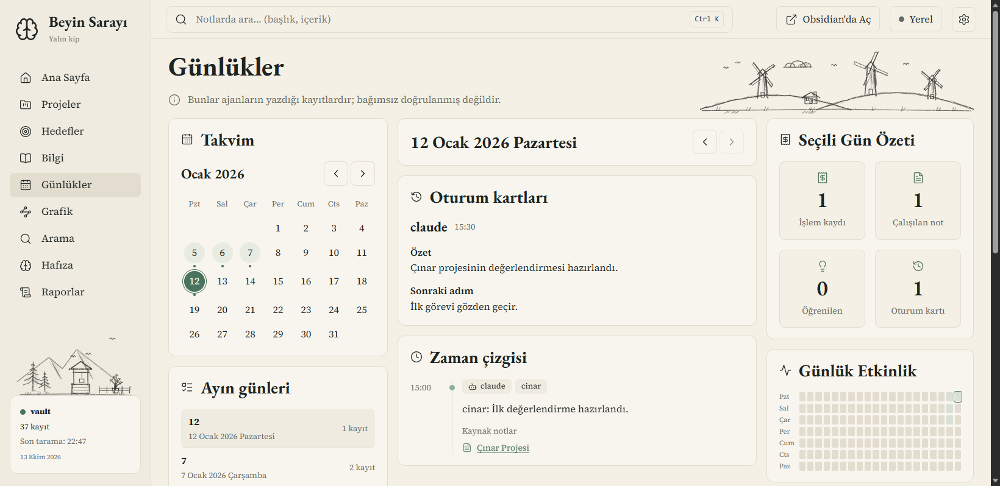
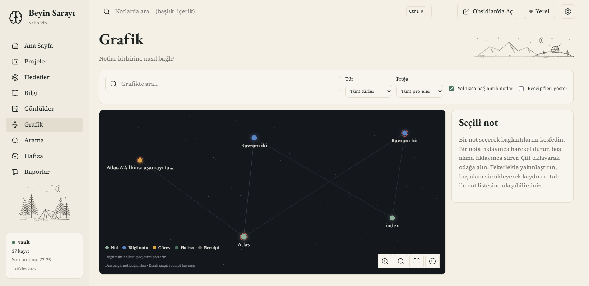
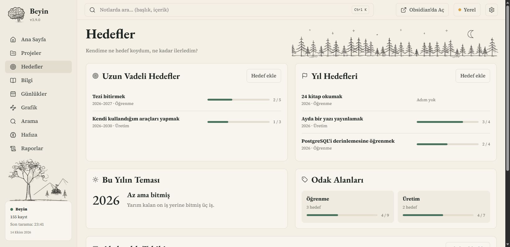

# beyin-web

**[avenoxbeyin](https://github.com/avenoxai/avenoxbeyin) (Beyin) için yerel web arayüzü.** Beyin'in vault'unda biriken notları, projeleri, görevleri, işlem kayıtlarını ve asistanın hafızasını Obsidian'ı bilmeden okunabilecek sadelikte gösterir.

> **Önce Beyin gerekir.** Bu arayüz tek başına bir not uygulaması değildir; gösterdiği kayıtları Beyin ve Beyin'le çalışan asistanınız vault'a yazar (görevler, receipt'ler, oturum kartları, kurallar, bilgi notları). Beyin kurulu olmayan bir klasörde sayfaların çoğu boş kalır. Kurulum: [avenoxbeyin](https://github.com/avenoxai/avenoxbeyin).

Sürüm 0.2.0 · [Değişiklikler](CHANGELOG.md) · [Kurulum rehberi](docs/INSTALL.md) · MIT



## Ne işe yarar?

Beyin her şeyi Markdown dosyalarında tutar; bu doğru bir tercih, ama dosya listesine bakarak "nerede kalmıştık, bu proje ne durumda, asistan hangi kurallara uyuyor" sorularını yanıtlamak zordur. beyin-web aynı dosyaları okuyup bu soruların yanıtını sayfalara dizer. Dosyaların yerini, biçimini ya da Beyin'in çalışmasını değiştirmez.

| Sayfa | Yanıtladığı soru | Beyin'de kaynağı |
|---|---|---|
| Ana Sayfa | Nerede kalmıştık, şu an ne açık? | Son oturum kartı, açık konular, görevler, receipt'ler |
| Projeler | Bu proje ne durumda, sırada ne var? | `project` alanı, proje notu, `tasks/`, receipt'ler |
| Hedefler | Kendime ne hedef koydum, ne kadar ilerledim? | `kind: goal` ve `kind: habit` notları (`goals/`) |
| Bilgi | Bu konuda ne öğrenmiştik? | `knowledge/` notları ve bağlantıları |
| Günlükler | O gün ne yapıldı? | `receipts/` ve oturum kartları |
| Grafik | Notlar birbirine nasıl bağlı? | Wikilink'ler ve receipt kaynakları |
| Arama | Şu kelime nerede geçiyor? Beyin bu konuda ne hatırlıyor? | Yerel kelime araması ve `beyin.py context` |
| Hafıza | Asistan beni nasıl tanıyor, hangi kurallara uyuyor? | Companion klasörü: kimlik, kurallar, son oturum, konular |
| Raporlar | Bu hafta ne oldu, birikim nereye gidiyor? | Receipt'ler ve notlardan sayılır; yapay zekâ özeti değildir |

| | |
|---|---|
|  |  |
|  |  |

Görüntüler, testlerde kullanılan sentetik örnek vault'la alınmıştır; içindeki notlar gerçek değildir.

## Beyin ile ilişkisi

- **Okur, değiştirmez.** Veriyi vault'taki Markdown dosyalarından alır. Beyin'in durum klasörüne (indeks, yedekler) hiç yazmaz.
- **Beyin'den yalnızca iki komut çağırır:** `doctor` (sürüm ve sağlık) ve `context --no-sync` (bağlam araması). İkisi de salt okunurdur. `sync`, `receipt`, `task-update` gibi yazan komutlar çağrılmaz.
- **Yalnızca Hedefler sayfası vault'a yazar:** hedef ve alışkanlık notları, sıradan Markdown olarak `goals/` klasörüne. Beyin bu notları sonraki eşitlemede kendisi indeksler; asistan da görür. `--read-only` bunu da kapatır.
- **Gizlilik Beyin'deki gibidir:** `visibility: private` notlar hiçbir sayfada, aramada ya da grafikte görünmez.
- **Bağımsız bir projedir.** avenoxbeyin'in parçası değildir ve onun güncellemesiyle gelmez; aynı lisansla (MIT) ayrı bir depoda geliştirilir. Beyin'e nasıl eklenebileceği [docs/UPSTREAM.md](docs/UPSTREAM.md) dosyasındadır.

## Gereksinimler

- Beyin (avenoxbeyin V3) kurulu bir vault.
- Python **3.11 ya da üstü**. Başka kurulum, pip paketi ya da derleme gerekmez.
- Güncel Edge, Chrome ya da Firefox.

## Kurulum

Bu depoyu indirin (ZIP indirdiyseniz açın) ve terminalde depo klasörüne girin. Aşağıdaki komutu **bir kez** çalıştırın; vault yolunu Beyin'i kurduğunuz Obsidian klasörüyle değiştirin.

Windows (PowerShell veya Komut İstemi):

```text
scripts\beyin-web.cmd --install --vault "C:\Users\KULLANICI\Documents\Beyin"
```

Linux, macOS ve WSL:

```sh
scripts/beyin-web --install --vault "$HOME/Documents/Beyin"
```

Kurulum bir kısayol bırakır; bundan sonra terminale gerek kalmaz:

| Ortam | Kısayol |
|---|---|
| Windows | Başlat menüsünde ve masaüstünde **Beyin Web** |
| Linux | Uygulama menüsünde **Beyin Web** |
| macOS | Masaüstünde `Beyin Web.command` |
| WSL | Windows'un Başlat menüsünde ve masaüstünde **Beyin Web**; tıklayınca WSL'i başlatır |

- **Açmak:** kısayola tıklayın; tarayıcı açılır. Arayüz zaten açıksa ikinci tıklama yenisini başlatmaz, açık olanı gösterir.
- **Ayarlar:** sağ üstteki dişli. Dil, imleç (koyu ya da sistemin imleci) ve Beyin'in rehberlerine bağlantılar buradadır.
- **Kapatmak:** Ayarlar → **Arayüzü kapat**. Kapatmayı unutursanız 30 dakika kullanılmayınca kendiliğinden kapanır.
- **Nereye kurulur:** arayüzün bir kopyası kullanıcı klasörünüze alınır (Windows'ta `%LOCALAPPDATA%\beyin-web`, Linux'ta `~/.local/share/beyin-web`, macOS'ta `~/Library/Application Support/beyin-web`); indirdiğiniz klasörü sonra silebilirsiniz. Vault yolu ayar dosyasına yazılır. **Vault'un içine hiçbir dosya konmaz.**
- **Güncellemek:** yeni sürümü indirip aynı komutu yeniden çalıştırın. Kısayol kurulan kopyayı açar, indirdiğiniz klasörü değil; komutu yeniden çalıştırmadan yeni sürüm görünmez.
- **Kaldırmak:** `scripts/beyin-web --uninstall` (Windows'ta `scripts\beyin-web.cmd --uninstall`). Kısayolları ve kopyayı siler; ayarlarınıza ve vault'unuza dokunmaz.

Kurulum Windows 11'de ve WSL'de (Ubuntu) denendi. Linux masaüstü ve macOS kısayolları otomatik testlerle sınandı, ama gerçek bir masaüstünde tıklanarak denenmedi; sorun görürseniz bildirin. Kısayolun simgesi karakalem bir beyindir (`beyin_web/assets/`); WSL kurulumunda simgenin bir kopyası Windows tarafına konur, böylece masaüstü çizilirken WSL uyandırılmaz.

### Beyin'in komutuyla kurulum (önizleme)

`upstream/beyin_v3_web.py`, Beyin'in `yakala` aracıyla aynı düzende küçük bir başlatıcıdır. Beyin'e alınırsa kurulum `beyin.py web kur` olur ve vault yolu sorulmaz ([docs/UPSTREAM.md](docs/UPSTREAM.md)). Beyin onu tanıyana kadar dosya tek başına çalışır:

```sh
python3 scripts/build_release.py
python3 upstream/beyin_v3_web.py --vault "$HOME/Beyin" kur --paket dist/beyin-web-0.2.0.zip
python3 upstream/beyin_v3_web.py --vault "$HOME/Beyin" durum
```

| Komut | Yaptığı |
|---|---|
| `kur [--paket ZIP] [--kisayol-yok] [--dil en]` | Sabitlenen sürümü indirir (ya da `--paket` ile vereni okur), dosyada yazılı SHA-256 ile doğrular, Beyin'in durum klasöründe `web/<sürüm>/` altına açar, kısayol bırakır. Özet tutmazsa hiçbir şey yazılmaz. |
| `ac` | Kurulu sürümü bu vault ile açar. |
| `durum` | Kurulu mu, hangi sürüm, güncel mi, çalışıyor mu. |
| `kaldir` | Kısayolu ve kurulu kopyayı siler; vault'a ve ayarlara dokunmaz. |

`scripts/build_release.py` her makinede aynı baytları veren ZIP'i ve yanındaki `.sha256` dosyasını `dist/` altına yazar, sürümü ve özeti başlatıcıya işler. Sürüm henüz GitHub'da yayınlanmadığı için indirme yolu bugün çalışmaz; `--paket` ile kurun.

## Kurmadan çalıştırma

Denemek ya da kendi seçeneklerinizle başlatmak için kurulum şart değildir. Örneklerde vault yolunu Beyin'i kurduğunuz Obsidian klasörüyle değiştirin.

Linux ve macOS:

```sh
scripts/beyin-web --vault "$HOME/Documents/Beyin" --open
```

Windows (PowerShell veya Komut İstemi):

```text
scripts\beyin-web.cmd --vault "C:\Users\KULLANICI\Documents\Beyin" --open
```

WSL, Windows'taki vault `/mnt/c/…` altındaysa (WSL terminalinde):

```sh
scripts/beyin-web --vault "/mnt/c/Users/KULLANICI/Documents/Beyin" --open
```

Arayüzü Beyin'in çalıştığı ortamda başlatın (Beyin WSL'de kuruluysa WSL'de). Başka ortamdan başlatmanız gerekiyorsa komuta `--no-beyin` ekleyin; arayüz o zaman notları gösterir, Beyin'e soru sormaz (yalın kip). Başlatıcı WSL'i kendiliğinden açmaz. Tarayıcı açılmazsa terminaldeki `beyin-web adresi: …` satırında verilen adresi elle açın. Kapatmak için terminalde `Ctrl+C` kullanın.

Ayrıntılar: [Kurulum rehberi](docs/INSTALL.md).

## Seçenekler ve ayarlar

| Seçenek | Anlamı |
|---|---|
| `--vault YOL` | Okunacak vault klasörü; boşluk içeren yolları tırnaklayın. |
| `--port SAYI` | Başlangıç portu; varsayılan 7373. Doluysa sonraki 20 porta kadar boş port aranır. `0` boş port seçtirir. |
| `--open` | Tarayıcıyı giriş adresiyle açar. |
| `--idle-exit DAKİKA` | Pozitif tam sayı; bu süre boyunca istek gelmezse kapanır. Varsayılan kapalıdır. Açık sekme istek gönderebilir. |
| `--no-token` | Belirteç ve çerez denetimini kapatır; yalnız tek kullanıcılı makine için. |
| `--no-beyin` | Yalın kipi zorlar; Beyin CLI'ı çağrılmaz. |
| `--read-only` | Vault'a hiçbir şey yazılmaz; Hedefler sayfası yalnızca gösterir. |
| `--lang tr\|en` | Arayüzün ve terminal mesajlarının varsayılan dili; verilmezse Türkçe. |
| `--install` | Bu kullanıcı için kurar: kopya, vault ayarı ve kısayol ("Kurulum" bölümü). `--vault` ve `--lang` ile birlikte verilir. |
| `--uninstall` | Kısayolları ve kurulu kopyayı siler. |
| `--reuse` | Aynı vault için çalışan bir arayüz varsa yenisini başlatmaz, onun adresini açar. Kısayol bunu kullanır. |
| `--version` | `beyin-web 0.2.0` yazdırıp çıkar. |

Vault keşif sırası: `--vault` → `BEYIN_VAULT` → `config.json` içindeki `vault` → bulunulan klasör (içinde `beyin.py` veya `.obsidian` varsa). Göreli yollar bulunulan klasöre göre çözülür; başlatıcı çalışma klasörünü değiştirmez. Öncelikli yol geçersizse sonraki aday denenmez.

`config.json` yeri:

- Windows: `%APPDATA%\beyin-web\config.json`; `APPDATA` yoksa `~/.config/beyin-web/config.json`.
- Linux, macOS ve WSL: `XDG_CONFIG_HOME` tanımlıysa `$XDG_CONFIG_HOME/beyin-web/config.json`, yoksa `~/.config/beyin-web/config.json`.

Dosyayı isteğe bağlı olarak kendiniz oluşturun. Desteklenen anahtarlar:

| Anahtar | Değer |
|---|---|
| `vault` | Vault yolu (metin). |
| `port` | 0–65535 arasında tam sayı; geçersizse 7373. `--port` önceliklidir. |
| `display_name` | Ana Sayfa selamlamasında kullanılan ad (metin). |
| `beyin` | `false` ise Beyin çağrıları kapatılır. |
| `read_only` | `true` ise vault'a yazılmaz (`--read-only` ile aynı). |
| `language` | `"tr"` ya da `"en"`; arayüzün varsayılan dili. `--lang` önceliklidir. |

```json
{
  "vault": "C:\\Users\\KULLANICI\\Documents\\Beyin",
  "port": 7373,
  "display_name": "Deniz",
  "beyin": false
}
```

Arayüz Türkçe ve İngilizcedir (*the interface is available in Turkish and English*). Üst çubuktaki **English** / **Türkçe** düğmesi dili değiştirir; seçim tarayıcıda saklanır ve `--lang` ile `language` ayarının önüne geçer. Adresler (`#/projeler`) ve notların içeriği dile göre değişmez.

## Güvenlik ve yalın kip

Sunucu yalnız `127.0.0.1` üzerinde dinler. İlk adres belirteç taşır; açılışta `HttpOnly; SameSite=Strict` çerez konur ve belirteç adres çubuğundan kaldırılır. Belirteç ayar klasöründeki `token` dosyasında tutulur; vault içinde ayar klasörü kullanılamaz. API GET ile okunur (HEAD de desteklenir). Vault'a yazan yalnızca Hedefler'in sekiz POST ucudur; dokuzuncu POST ucu Ayarlar'daki "Arayüzü kapat" düğmesinindir ve hiçbir dosyaya yazmaz. Bunlar isteğin arayüzün kendi sayfasından geldiğini (`Origin`, JSON türü ve özel başlık) denetler, başka sitenin ya da formun isteğini reddeder. Katı CSP uzak kaynakları ve satır içi betikleri engeller. Gizli (`visibility: private`) notlar veri katmanında elenir. Beyin'in durum klasörüne yazılmaz; dışarı ağ isteği, telemetri veya CDN kullanılmaz. Belirteçli adresi paylaşmayın.

**Yalın kip**, arayüzün Beyin'in çalışma zamanına ulaşamadığı durumdur (`beyin.py` vault'ta yok, `--no-beyin` verilmiş ya da Beyin başka ortamda kurulu). Vault'taki notlar, projeler, görevler, günlükler, grafik, hafıza dosyaları ve yerel arama yine gösterilir; Beyin'in bağlam araması ile sağlık ve sürüm bilgileri gösterilemez. Bu kip Beyin'in yerini tutmaz: gösterilen kayıtları yine Beyin üretmiş olmalıdır.

## Hedefler vault'ta nasıl durur?

Hedefler sıradan Markdown notlarıdır; Obsidian'da ya da asistanınızla da yazabilirsiniz; arayüz hepsini gösterir.

```markdown
---
{
  "kind": "goal",
  "horizon": "year",
  "period": "2026",
  "area": "Öğrenme",
  "visibility": "internal"
}
---
# 12 kitap okumak

- [x] Birinci kitap
- [ ] İkinci kitap
```

- `horizon`: `long` (uzun vadeli), `year` (yıl hedefi) ya da `theme` (yılın teması; adımı olmaz, ilk paragrafı gösterilir).
- İlerleme nottaki görev kutularından sayılır. Arayüzde bir adımı işaretlemek o satırdaki tek karakteri değiştirir.
- Alışkanlık `"kind": "habit"` notudur; yapılan her gün `- 2026-01-12` biçiminde bir satırdır.
- Arayüzden eklenen notlar vault'un `goals/` klasörüne yazılır. Var olan bir dosyanın üzerine yazılmaz. Not arayüz açıkken başka bir yerde değiştiyse arayüz kendi değişikliğini bırakır ve güncel hali gösterir.
- Arayüzde silinen hedef ya da alışkanlık yok edilmez; vault'un `.trash` klasörüne (Obsidian'ın çöp kutusu) taşınır ve Hedefler sayfasının altındaki Çöp Kutusu'nda görünür. Oradan geri alınır ya da onay verilirse kalıcı olarak silinir; kendiliğinden hiçbir şey silinmez. Çöp Kutusu yalnızca hedef ve alışkanlık notlarını gösterir; `.trash` içindeki başka notlara dokunmaz.
- Bir hedefin başlığını ya da adımlarının metnini düzeltmek için notu Obsidian'da açın; arayüz metin düzenlemez.
- `"visibility": "private"` hedef arayüzde hiç görünmez.

## Çizimler

Arayüzde karakalem tarzında 31 çizim vardır: Ana Sayfa karşılamasında sekiz, yan menünün altında yedi, sayfa başlıklarında sekiz, kart köşelerinde ve boş kutularda sekiz. Bunlara ek olarak 16 küçük karalama (spiral, yıldız, kâğıt uçak, XOX gibi) sayfanın boş kalan yerlerine, öbür çizimlerden uzağa serpiştirilir; dolu bir sayfada hiç görünmezler. Her yer kendi çizimlerinden birini rastgele gösterir; seçim sayfa yeniden yüklenene kadar değişmez. Çizimleri `scripts/draw_illustrations.py` üretir (tarifler betiğin içindedir, sonuç her çalıştırmada aynıdır) ve `beyin_web/static/img/` altına yazar.

Kendi çiziminizi eklemek için dosyayı aynı klasöre yuvanın adıyla koyun: `hero-palace-benim.png`, `sidebar-tree-2.svg`, `heading-mountains-kis.webp`, `card-window-01.png`, `margin-doodle-kedi.png` gibi (küçük harf, rakam ve tire; PNG, SVG ya da WebP). Arayüz yeniden başlatıldığında o da rastgele seçilenler arasına girer. Kâğıt zeminine oturması için arka planı saydam ya da beyaz olmalıdır.

## Sınırlar

Not düzenleme ve oluşturma yoktur; yazılabilen yalnızca hedefler ve alışkanlıklardır. Koyu tema ve mobil düzen yoktur; en düşük genişlik **1.024 px**'dir. Arama `ı`/`i` ayrımı yapmaz.

## Geliştirme ve ölçüm

```sh
python -m unittest discover -s tests -t .
node --test tests/js
```

`tests/e2e/` altındaki tarayıcı testleri aynı Python keşif komutuna dahildir. Ayrı çalıştırmak için:

```sh
python -m unittest discover -s tests/e2e -t .
```

Linux/macOS/WSL'de gerektiğinde `python` yerine `python3`, Windows'ta `py -3` kullanın. Tarayıcı testleri geliştirme ortamında Selenium ve yerel Edge sürücüsü gerektirir; bulunmazsa atlanır. Testler gerçek vault'u okumaz ve dışarı ağ isteği yapmaz.

Salt okunur performans ölçümü (kendi vault yolunuzla):

```sh
python scripts/measure.py VAULT
python scripts/measure.py VAULT --api --no-beyin --repeat 20 --idle 60
```

İlk komut `cold_ms`, `warm_ms`, türlere göre sayılar, `warnings` ve belleği yazdırır. İkincisi yerel API'nin ilk, ortanca ve en büyük sürelerini ve boşta işlemci yüzdesini ekler. Veri veya Beyin gerektiren ölçümler karşılıkları yoksa `atlandı` olur. Bellek yalnız `/proc/self/status` üzerinden ölçülür; diğer ortamlarda `rss_mb: unavailable` yazılır. Beyin çağrılarını da ölçmek için `--no-beyin` seçeneğini kaldırın.

[Kurulum](docs/INSTALL.md) · [Performans raporu](docs/PERFORMANCE.md)

Lisans: [MIT](LICENSE), avenoxbeyin ile aynı.

## In English

beyin-web is a local, read-mostly web interface for [avenoxbeyin](https://github.com/avenoxai/avenoxbeyin) ("Beyin"), a local second brain for coding agents that keeps everything in Markdown inside an Obsidian vault. It shows what Beyin has written there (projects, tasks, receipts, session cards, rules, knowledge notes) on plain pages for people who do not want to learn Obsidian. **It needs a vault managed by Beyin; on its own it has nothing to show.** It never writes to Beyin's state folder, calls only `doctor` and `context --no-sync`, and writes to the vault only from the Goals page. Python 3.11+, no dependencies, no build step. The interface is in Turkish and English (`--lang en`, or the button in the top bar); the documentation is in Turkish.
